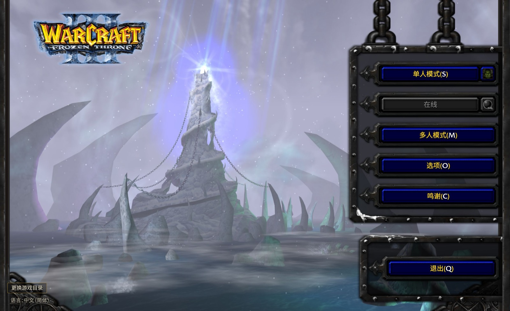
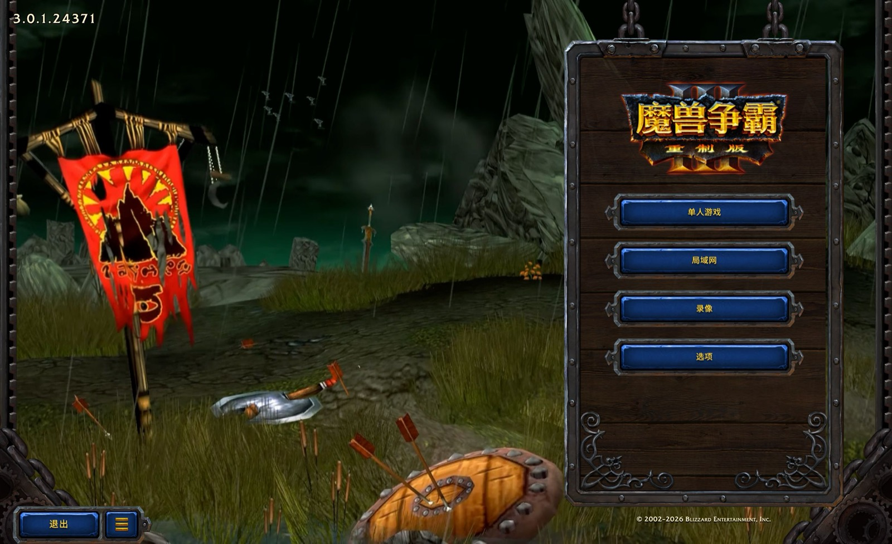
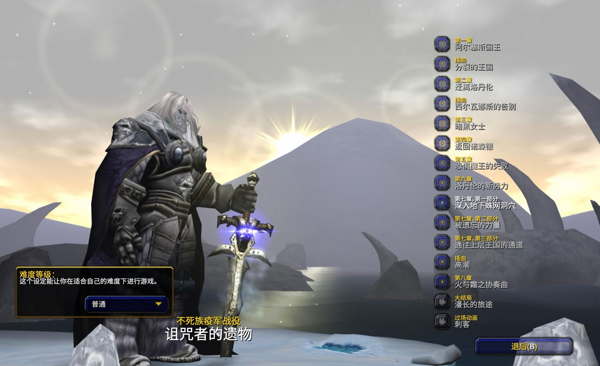
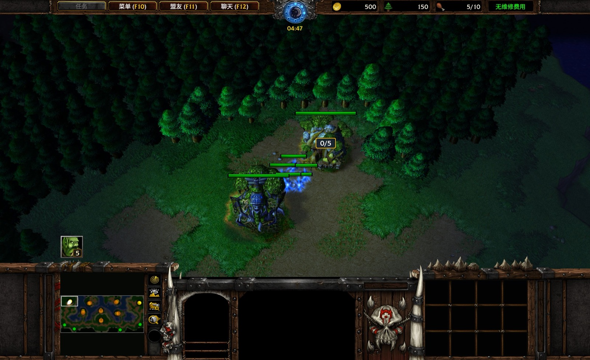

# 魔兽争霸开源版（Warcraft Open）

> 用 TypeScript 从零重写的《魔兽争霸 III：冰封王座》引擎，浏览器与桌面端皆可运行。
> **不包含任何暴雪游戏文件**，运行时只读取你自己电脑上的游戏安装目录。

<p>
  <a href="https://warcraft.hhkj.me/"><b>🌐 在线试玩</b></a> ·
  <a href="../../releases"><b>⬇️ 下载桌面版 / 安卓版</b></a> ·
  <a href="docs/"><b>📚 开发文档</b></a> ·
  <a href="CONTRIBUTING.md"><b>🤝 参与贡献</b></a>
</p>

- **在线地址**：https://warcraft.hhkj.me/
- **作者 QQ**：360268423
- **交流 QQ 群**：567744625


---

## 项目简介

魔兽争霸开源版（Warcraft Open）是一套用 **TypeScript** 实现的《魔兽争霸 III：冰封王座》
（TFT 1.30.4）游戏引擎。它不打包、不修改、不分发任何暴雪资源：启动时由你指定本机的
Warcraft III 安装目录（1.30.4 CASC，或自动降级兼容的 1.31.1），引擎在运行时读取并解析其中的
贴图、模型、音效、地图与数据表，因此画面、单位和技能数值都与原版一致。

项目从渲染、寻路、单位行为、物品与技能，到英雄系统、触发器脚本（JASS）、战役、
联机同步与 HUD 布局，全部按原版机制逐个复刻，并用真实游戏数据反复校对。除了浏览器版本，
还提供 Windows / macOS / Linux 桌面版（Electron，自动更新）与安卓 APK；既可以玩经典版
（SD，1.30.4 原版美术），也能切换到重制版（HD，读取 3.x 安装包的模型与界面）。

A browser-first, asset-compatible re-creation of the **Warcraft III: The Frozen Throne**
engine in TypeScript. It ships **zero Blizzard assets or code** — the engine reads the Warcraft III
installation you point it at, at runtime. Online demo: <https://warcraft.hhkj.me/>

## 游戏截图

| 经典版（SD）主菜单 | 重制版（HD）主菜单 |
| --- | --- |
|  |  |
| **战役**：读取安装包内的章节并正常显示 | **对局**：原版模型、地形、战争迷雾与 HUD |
|  |  |

## 核心特性

### 游戏内容

- **四大种族完整对战**：人族、兽族、不死族、暗夜精灵，含科技树、升级、商店、酒馆、
  中立建筑与野怪营地。
- **英雄系统**：技能学习、属性成长、物品栏、复活、经验与光环。
- **战役模式**：读取安装包内的战役章节并正常开局（[实现说明](docs/campaigns.md)）。
- **混沌之治 / 冰封王座双版本**：主菜单可切换两个资料片（[实现说明](docs/editions.md)）。
- **自定义地图**：支持 JASS 触发器、自定义单位与技能；对 1.30.4 之后保存的地图提供
  兼容层（[说明](docs/map-compatibility.md)）。
- **存档与录像**：随时保存 / 载入战局，并把整局对局录制为可回放的录像文件。
- **经典版（SD）与重制版（HD）**：同一份引擎代码，按你的安装包选择美术与界面风格。

### 联机与 AI

- **局域网 + 在线联机**：桌面版开箱即用，在线地址为 https://warcraft.hhkj.me/
  （[联机实现](docs/multiplayer.md)）。
- **断线重连**：掉线不再意味着整局作废。
- **WebRTC 直连**：对局内客户端与主机建立可靠有序的 DataChannel，中继只负责信令与兜底。
- **Computer+**：不作弊、会侦察、会转型的加强版电脑 AI（[实现说明](docs/computer-plus.md)）。
- **观察者 HUD**：观战席拥有独立界面与视角控制（[说明](docs/observer-hud.md)）。
- **语音聊天**：联机时按住按键说话。

### 操作与体验

- **快捷键编辑器**：在游戏内重绑任意命令卡，并写回 `CustomKeys.txt`（[说明](docs/hotkeys.md)）。
- **大编队与全选军队**：支持超常规编队数量与 `-` 一键选中全部部队。
- **内置地图下载器**：在地图列表中搜索并下载 EpicWar 地图，浏览 Hive Workshop 与 wc3maps；
  联机时若缺少房主地图会自动下载。
- **手柄支持**：标准手柄布局，按键会被翻译成鼠标 / 键盘输入（[说明](docs/gamepad.md)）。
- **语音控制**：面向无障碍场景的命令识别模式。
- **多语言界面**：简体中文 / English 随时切换。

### 渲染与性能

- **WebGL2 渲染管线**：MDX / M3 模型、地形与悬崖、水面、粒子、法术特效、阴影与天气。
- **Tileset 叠加**：正确处理各资料片按嵌套归档区分的悬崖、水面与可替换贴图。
- **确定性模拟 + 快照同步**：模拟与渲染分离，联机采用增量快照与兴趣区域裁剪。
- **性能日志**：每帧耗时、子系统开销与对象统计可回放分析（[说明](docs/perf-logging.md)）。

## 快速开始

### 直接游玩

1. 打开在线地址 <https://warcraft.hhkj.me/>，或到 [Releases](../../releases) 下载桌面版
   （Windows / macOS / Linux）与安卓 APK。
2. 首次启动时选择你的 Warcraft III 游戏目录。引擎不会上传任何游戏文件。
3. 没有游戏文件？可到[官网资料下载页](https://warcraft.hhkj.me/zh/downloads)获取中文版或英文版。

### 从源码运行

```bash
pnpm install
pnpm dev      # 开发服务器：http://localhost:5173
pnpm build    # 类型检查 + 生产构建
pnpm app      # 构建后启动桌面版
pnpm test     # 全部检查（依赖游戏数据的套件在缺少安装目录时自动跳过）
```

更细的开发约定、数据来源与参考资料见 [CLAUDE.md](CLAUDE.md) 与 [docs/](docs/)。

## 项目结构

| 目录 | 内容 |
| --- | --- |
| [`src/vfs/`](src/vfs/) | CASC / MPQ 虚拟文件系统、安装目录识别与版本降级 |
| [`src/world/`](src/world/) | 地图与地形解析、可破坏物、路径与区域 |
| [`src/data/`](src/data/) | 从游戏数据表生成的对象数据（单位、技能、物品、升级） |
| [`src/sim/`](src/sim/) | 确定性模拟：单位、命令、战斗、经济与寻路 |
| [`src/game/`](src/game/) | 对局组织、玩家、镜头、输入、同步与观察者 |
| [`src/render/`](src/render/) | WebGL2 渲染、模型、地形、特效、天气与闪电 |
| [`src/ui/`](src/ui/) | 启动器、FDF 界面、HUD、快捷键、选项与手柄 |
| [`src/jass/`](src/jass/) | JASS 触发器虚拟机与原生函数 |
| [`src/net/`](src/net/) | 联机传输、WebRTC 直连与断线重连 |
| [`electron/`](electron/) | 桌面版外壳、自动更新与本地文件访问 |

## 文档

- [地图与数据格式](docs/wc3-data-formats.md) · [CASC 归档](docs/casc.md) · [参考资料索引](docs/REFERENCES.md)
- [触发器 / JASS 进度](docs/triggers.md) · [战役](docs/campaigns.md) · [联机](docs/multiplayer.md)
- [Computer+ AI](docs/computer-plus.md) · [观察者 HUD](docs/observer-hud.md) · [手柄](docs/gamepad.md) · [快捷键](docs/hotkeys.md)
- [性能日志](docs/perf-logging.md) · [对局日志](docs/match-log.md) · [光照](docs/lighting.md) · [地形裁剪](docs/terrain-culling.md) · [法术特效](docs/spell-fx.md)

## 社区与反馈

- 在线地址：<https://warcraft.hhkj.me/>
- 作者 QQ：**360268423**
- 交流 QQ 群：**567744625**
- 问题与建议：优先在 [Issues](../../issues) 提出；也欢迎阅读 [CONTRIBUTING.md](CONTRIBUTING.md) 后直接提交 PR。

## 赞赏支持

如果这个项目帮到了你，可以请作者喝杯咖啡。**赞赏完全自愿，不影响任何功能**，也不代表任何形式的商业授权或技术支持承诺。

| 微信 | 支付宝 |
| --- | --- |
|  |  |

## 免责声明

本项目为原创代码，**不包含任何暴雪娱乐的游戏资源或代码**。所有贴图、模型、音效与地图都在运行时
从用户本机的游戏安装目录读取，不会上传。Warcraft、Warcraft III 及相关名称与素材归暴雪娱乐所有。

代码以 [MIT License](LICENSE) 授权。
